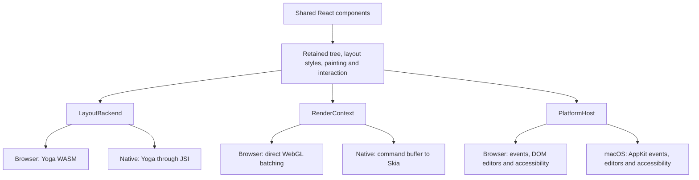

# Portable runtime and macOS proof

This is the first portability milestone: a shared React UI runs in the browser
and in a standalone macOS application using Hermes, native Yoga and Skia/Metal.
The native entry point is experimental. Android, iOS, Windows and Linux host
implementations are future work; this milestone does not claim support for them.

## Architecture



React continues to run at runtime. The build bundles TypeScript/TSX into
JavaScript, compiles that bundle into Hermes bytecode, and packages it with a
compiled native host. It does not translate arbitrary React code into Swift,
Kotlin or C++, and it does not use a WebView. Application state and frame-loop
ownership remain with the application.

`ludic-canvas` preserves the browser API. `ludic-canvas/core` exports components,
`createPortableUI`, platform contracts, `CommandRenderer`, `RecordingRenderer`
and `createHeadlessHost`. `ludic-canvas/native` adds `createNativeUI` for a
compatible embedding. Both portable entry points typecheck without DOM libs.

The browser keeps its direct WebGL batch. Recording and replay are used by the
native adapter and tests, so existing browser frames do not acquire another
command-copy pass.

## Build and run the proof

From this repository checkout, use Node 24, macOS 26 or later, Xcode with its command-line tools, CMake, Ninja
and Python 3. The acquired build is Apple silicon; Intel Macs and older macOS
versions have not been qualified. Initial dependency compilation takes several
minutes. Sources are cached under `.toolchain/native`, and outputs under
`build/native`; neither directory is published in the npm package.

```sh
npm ci
npm run native:build
npm run native:test
open build/native/app/ludic-native.app
```

`examples/portable/App.tsx` is used unchanged by both hosts. The browser entry
is available at `/examples/portable/` with `npm run test:browser:serve`.
The native entry is intentionally small:

```tsx
import { createNativeUI } from 'ludic-canvas/native';
import { App } from './App';

const ui = createNativeUI({ title: 'My interface', width: 720, height: 640 });
ui.render(<App />);
```

For a different entry and bundled assets:

```sh
npm run native:build -- --entry path/to/native.tsx --assets path/to/resources
```

The build alias maps shared `ludic-canvas` imports to the core entry. In this
checkout, a native entry may import `src/native.ts` directly; package imports
use the corresponding published declarations/build. Use bundle-relative font
and image paths. Native apps do not implicitly fetch URLs or rasterize SVGs.
The existing offline font-atlas CLI remains the font preparation step.

Dependencies and archive checksums are pinned in
[`tools/native/dependencies.json`](../tools/native/dependencies.json).
Hermes bytecode and the embedded runtime are built from the same source revision.
The native application includes dependency license files and build metadata.
The proof is a local development bundle, without signing, notarization,
installer, app-store or automatic-update packaging.

## Adapter contracts

| Boundary         | Responsibility                                                                                                                                                                    |
| ---------------- | --------------------------------------------------------------------------------------------------------------------------------------------------------------------------------- |
| `LayoutBackend`  | Root-owned layout configuration, node lifetime, measurement callbacks and bulk box reads. Native IDs are opaque integers, never truncated pointers.                               |
| `RenderContext`  | Rectangles, borders, gradients, images, atlas glyphs, glows, lines and rectangular clipping. Coordinates are device pixels with a top-left origin; colors are premultiplied RGBA. |
| `PlatformHost`   | Logical surface size and scale, normalized input, native focus/editors, semantic output, announcements and scheduling.                                                            |
| `PortableImages` | Asset lookup, preload, invalidation, byte accounting and release.                                                                                                                 |

`createPortableUI` takes ownership of the supplied services. Each root gets a
separate layout context, renderer, host and image provider. The renderer/host
owns texture handles, including font atlases. Destroy cancels the root frame
loop, unmounts React and releases services; it is idempotent. A custom scheduler
must supply a monotonic millisecond clock. React also needs ordinary JavaScript
timers and microtasks; the Hermes embedding installs them before loading a bundle.

The native runtime is accessed only on its owning thread. JSI callbacks and
layout measurement closures are released before destroying Hermes. Automatic
frames currently use host timers, rather than display synchronization.
Closing a window destroys its root; quitting the app closes every owned root
before shutting down the VM. The proof supplies timers, microtasks, a clock and
console output, but no DOM, Node, network-fetch or Intl APIs.

`CommandRenderer` emits fixed-width float records plus a separate resource table
in one submission per frame. Protocol version and stride are exported. The buffer
is borrowed until the next frame; retaining backends copy it. `drawCalls` reports
backend submissions, not measured GPU execution or a comparable native/WebGL
performance score. `RecordingRenderer` acquires commands without rendering pixels.

Pointer hits and wheel routing share the same paint-order logic on both hosts.
`isPointerOverUI({ x, y })` uses root-local logical coordinates. Browser events
use `clientX/clientY`, including when they also expose `x/y` aliases. A host
without browser viewport coordinates treats the compatibility form as root-local.

## Native editing and accessibility boundary

AppKit owns editable text, selection, caret and undo. Yoga supplies the boxes and
Skia supplies decoration. The portable input layer owns controlled-value
synchronization, keyboard routing, modal focus policy and imperative handles.
Accepted prop echoes keep the native editor and selection; external replacements
clamp selection. Composition drafts and queued external resets have headless
contract coverage, but real OS IME qualification remains outstanding.

The macOS proof implements single-line/password and multiline editors, basic
font/size/color/alignment/insets, native clipboard menu commands, controlled
editing, keyboard activation, modal focus and an accessibility tree. It does not
yet provide full browser-editor parity: multiline placeholders, letter spacing,
line-height styling, keyboard/autofill hints, accessible error descriptions and
native-editor wheel chaining need dedicated follow-up. Use topmost forms;
arbitrary canvas/native-editor interleaving remains unsupported.

Accessibility elements and native actions are inspected during the smoke test.
That evidence is not a VoiceOver qualification. Real IME, assistive technology,
long sessions, device loss, app suspension/resume and GPU allocation reclamation
remain separate acquisition work. See the [verification record](PORTABILITY_RESULTS.md).

## Next ports

Keep one component API and add host implementations. The next useful milestone
is Android: exercise touch, keyboard/composition, accessibility and lifecycle
against these contracts before extending to iOS, Windows and Linux. Each port
needs its own window/surface integration, platform editors, accessibility bridge,
asset/package tools and device evidence. Skia/Hermes portability does not supply
those integrations automatically.

The embedding design was researched through DeepWiki for `facebook/hermes` and
`meta/hermes`, then checked against the pinned
[Hermes API](https://github.com/facebook/hermes/tree/26fbb82fad39d9d06901adb1d6d630dacc84c877/API)
and [Skia headers](https://github.com/google/skia/tree/607de4b035dcf7fdbaafb66c6cc04f22009ff4d4/include).
Generated examples were treated as leads: the actual pinned JSI, microtask and
Skia APIs determine the implementation.
